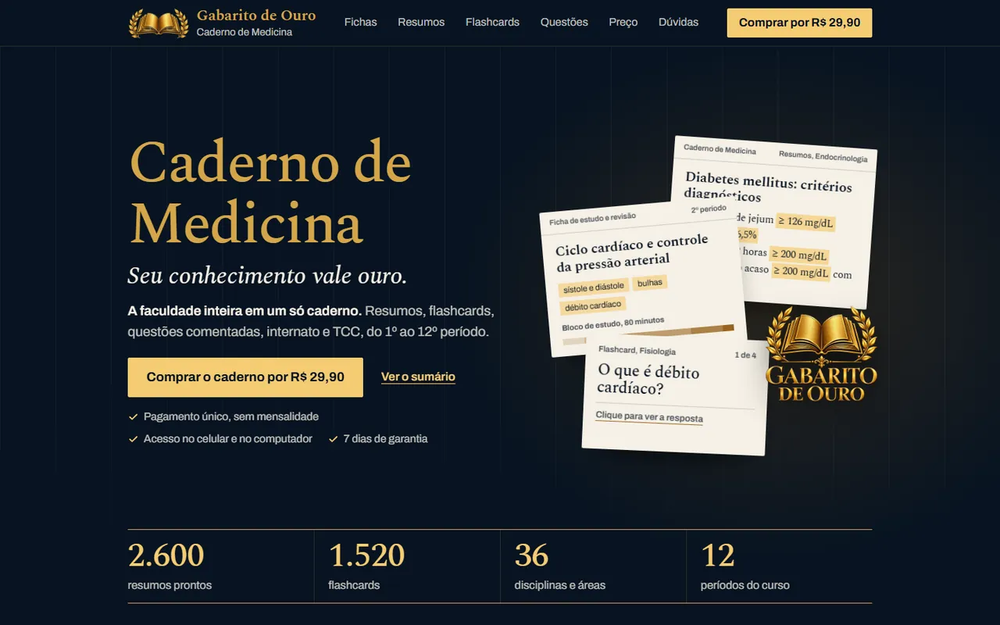

<div align="center">

# Gabarito de Ouro: Caderno de Medicina

**Página de venda de um caderno digital de estudos para quem cursa Medicina, do 1º ao 12º período.**


</div>

<p align="center">
  
  
</p>

## Sobre

O Gabarito de Ouro é uma linha de cadernos digitais por curso. Este repositório é a página de venda
do **Caderno de Medicina**, que reúne fichas de estudo, resumos, flashcards com revisão espaçada,
questões comentadas, diário de internato e modelos de TCC, organizados por período e por disciplina.

A página não descreve o produto só com texto: ela mostra pedaços do caderno funcionando. O visitante
vira um flashcard, abre a ficha de cada período e responde a uma questão antes de decidir a compra.

## Destaques

- **Capa com o caderno sobre a mesa.** Três páginas de marfim (resumo, ficha e flashcard) aparecem
  sobrepostas e acompanham o ponteiro do mouse. O flashcard vira ao toque e, na entrada, mostra uma
  resposta sozinho para ensinar o gesto.
- **Fichas por período.** Abas do 1º ao 12º período (`role="tablist"`, navegação pelas setas do teclado)
  montam a ficha de estudo de cada fase: tema, palavras-chave, bloco de estudo de 80 minutos dividido em
  etapas e três atividades práticas.
- **Baralho de amostra com revisão espaçada.** O cartão gira no próprio eixo, o visitante avalia a
  própria resposta e o próximo cartão sobe. Ao lado, os intervalos do algoritmo SM-2 explicam quando
  cada cartão volta. Uma galeria de cartões completa a amostra, com botão para mostrar o restante.
- **Questão comentada.** Uma questão no estilo das provas de residência: ao marcar a alternativa, a
  página mostra o gabarito explicado e permite refazer.
- **Amostras realistas.** Índice de resumos em tabela, página de resumo de Endocrinologia, diário de
  internato, caso clínico de urgência e três modelos de TCC (revisão de literatura, estudo
  observacional e relato de caso).
- **Feita para o celular.** Fileiras deslizantes com marcador de posição, grupos de "o que está
  incluído" que se reorganizam abaixo de 620 px e ajuste fino para telas de 320 px.
- **Barra de compra no celular.** Aparece depois que o botão da capa sai da tela e some quando a
  seção de preço está visível, para não repetir o mesmo botão.
- **Oferta em um só lugar.** Link de checkout, valor, e-mail de suporte, processador de pagamento e
  CNPJ ficam no objeto `OFERTA` do script; a página inteira acompanha (campos vazios não aparecem).
- **Leitura com cara de livro.** Capítulos numerados em romanos como num sumário, linha de progresso
  da leitura no topo, contadores animados e revelação suave ao rolar.

## Seções da página

1. **Capa**: nome do caderno, "Seu conhecimento vale ouro.", chamada de compra e números do caderno.
2. **Sumário**: os dez capítulos da página, com âncoras.
3. **I. Fichas de estudo** (`#fichas`): abas por período, agrupadas em ciclo básico, ciclo clínico e internato.
4. **II. Resumos** (`#resumos`): amostra do índice, uma página de resumo e as grandes áreas.
5. **III. Flashcards** (`#flashcards`): baralho interativo, intervalos de revisão e galeria de cartões.
6. **IV. Disciplinas** (`#disciplinas`): grade por período e as disciplinas e áreas do curso.
7. **V. Práticas e internato** (`#internato`): modelos de registro, diário por rodízio e caso clínico.
8. **VI. Questões** (`#questoes`): ENADE, residência médica e Revalida, com questão interativa.
9. **VII. TCC e pesquisa** (`#tcc`): três modelos de TCC, normas e ética em pesquisa.
10. **VIII. Para cada fase** (`#fases`): como o caderno ajuda do primeiro período à vida de médico formado.
11. **IX. Preço e garantia** (`#preco`): recibo com formas de pagamento, acesso, garantia e tudo o que está incluído.
12. **X. Perguntas frequentes** (`#perguntas`): acesso, uso no dia a dia, pagamento, reembolso e suporte.
13. **Rodapé** e barra de compra fixa no celular.

## Tecnologias

| Camada | Ferramentas |
| --- | --- |
| Interface | HTML, CSS e JavaScript puros, em um único `index.html` (sem framework e sem build) |
| Tipografia | Spectral (títulos, com cara de livro) e Archivo (interface), via Google Fonts |
| Identidade | Paleta marinho, ouro e marfim definida em variáveis CSS, com tema claro por seção (`.claro`) |
| Animação | Web Animations API, transições CSS e `IntersectionObserver` |
| Medição | Pixel da Meta e script da UTMify |
| Pagamento | Checkout externo configurado no objeto `OFERTA` |

## SEO, desempenho e acessibilidade

- `lang="pt-BR"`, título, meta description, URL canônica, Open Graph com imagem (`assets/og.jpg`) e cartão grande do Twitter.
- `theme-color`, favicon e ícone para a tela inicial do iPhone (`assets/icone-180.png`).
- Fontes com `preconnect` e `display=swap`; emblemas em WebP com `width`, `height` e `loading="lazy"`.
- Respeita `prefers-reduced-motion`: sem contagem, sem revelação, sem paralaxe e sem giro animado.
- Abas acessíveis (`tablist`, `tab`, `tabpanel`, `aria-selected`), elementos decorativos com `aria-hidden`.
- Links da barra fixa saem da ordem de tabulação quando ela está escondida.

## Estrutura

```text
index.html              página completa: estilos, marcação e scripts
assets/
  emblema.webp          emblema dourado da marca
  emblema-livro.webp    emblema usado no recibo da oferta
  favicon.png
  icone-180.png         ícone para a tela inicial
  og.jpg                imagem de compartilhamento
docs/                   prints usados neste README
```

## Como rodar localmente

Não há dependências nem build. Basta servir a pasta:

```bash
python -m http.server 8000
# ou
npx serve .
```

E abrir `http://localhost:8000`.

## Como editar

- **Oferta**: no começo do `<script>` principal, o objeto `OFERTA` guarda checkout, valor, e-mail de suporte,
  processador e CNPJ.
- **Fichas por período**: a lista `PERIODOS` no mesmo script define o tema, as palavras-chave e o caso de cada período.
- **Cores**: as variáveis `--marinho`, `--ouro`, `--ouro-luz`, `--ouro-velho` e `--marfim` no topo do CSS.

## Família Gabarito de Ouro

A mesma base de página foi adaptada para outros cursos:

| Repositório | Caderno |
| --- | --- |
| [study-guide](https://github.com/MatheusMattos-Dev/study-guide) | Medicina, do 1º ao 12º período |
| [study-guideV2](https://github.com/MatheusMattos-Dev/study-guideV2) | Psicologia, do 1º ao 10º período |
| [study-guideV3](https://github.com/MatheusMattos-Dev/study-guideV3) | Pedagogia, do 1º ao 8º período |

## Deploy

Site estático sem etapa de build: qualquer hospedagem estática, como a Vercel, publica a pasta como está.

---

<sub>Feito por [Matheus Mattos Chaves](https://matheusdev-lovat.vercel.app) · [GitHub](https://github.com/MatheusMattos-Dev)</sub>
